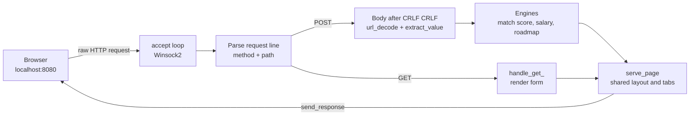
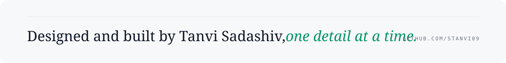

<picture>
  <source media="(prefers-color-scheme: dark)" srcset=".github/assets/header-dark.svg">
  
</picture>

<picture>
  <source media="(prefers-color-scheme: dark)" srcset=".github/assets/stats-dark.svg">
  
</picture>

<br>

## 01 &nbsp; Why C?

Every placement-prep site I found was either generic or behind a login. I wanted something that looks at **my** CGPA, **my** skills and **my** backlogs and tells me where I stand.

I also wanted to know what a web framework actually *does*. So I wrote all of it in plain C: the socket, HTTP parsing, routing, form decoding and every pixel of HTML. Nothing sits between my code and the network.

## 02 &nbsp; The nine tools

| Route | Tool | What it does |
|---|---|---|
| `/` | **Eligibility Predictor** | Scores your profile 0 to 100 against 12 recruiters and estimates a salary band |
| `/resume` | **Resume Scorer** | Checks a resume against recruiting standards and lists concrete fixes |
| `/compare` | **Recruiter Comparison** | Two companies side by side: cut-offs, tier, pay, required skill |
| `/roadmap` | **Study Roadmap** | A week-by-week plan for your target domain and level |
| `/interview` | **Mock Interview Prep** | Company-specific questions with hints |
| `/simulator` | **CGPA Simulator** | *If I reach 8.0, which companies open up?* |
| `/backlogs` | **Backlog Counselor** | Who still hires with backlogs, and a plan to clear them |
| `/resume-gen` | **Tailored Resume Builder** | A draft that highlights what one recruiter looks for |
| `/reviews` | **Senior Reviews** | Placement stories from seniors, filterable by company |

Recruiters modelled: Google, Microsoft, Amazon, Goldman Sachs, JP Morgan, Deloitte, Accenture, Infosys, TCS, Wipro, ISRO and L&T Technology, across Tech, Finance, Consulting and Core, in tiers A, B and C.

## 03 &nbsp; Anatomy of a request



## 04 &nbsp; Decisions I'd defend in an interview

- **Winsock is loaded at runtime.** The program calls `LoadLibraryA("ws2_32.dll")` and resolves `socket`, `bind`, `listen`, `accept`, `recv` and `send` with `GetProcAddress`. That's what lets it build with **TinyCC**, which ships without the Winsock import library.
- **A hand-written HTTP layer.** Request-line parsing, a route table of 9 GET and 8 POST routes, `x-www-form-urlencoded` decoding and response headers, all written by hand.
- **A scoring model you can explain.** CGPA margin over the cut-off (capped at 40), backlog policy, the required skill, breadth of skills, projects, internships, and LeetCode count for tier-A tech. Salary scales the company's base by score, CGPA and internships, kept within **70 to 130%** of base.
- **Bounded memory.** Plain structs with fixed-size fields, and each page is built in one pre-sized buffer that's freed after sending.

<details>
<summary><b>Read the scoring function</b></summary>
<br>

```c
int compute_match_score(const Student *s, const Company *c) {
    int score = 0;
    if (s->cgpa >= c->min_cgpa) {
        float extra = s->cgpa - c->min_cgpa;
        score += 25 + (int)(extra * 3);
        if (score > 40) score = 40;
    } else if (c->min_cgpa - s->cgpa < 0.5f) score += 10;

    if (s->backlogs == 0)                           score += 10;
    else if (c->allow_backlogs && s->backlogs <= 2) score += 5;
    if (has_skill(s, c->required_skill))            score += 15;
    /* + breadth of skills, projects, internships, LeetCode for tier-A tech */
    return score > 100 ? 100 : score;
}
```
</details>

## 05 &nbsp; Details I obsessed over

- **One layout, nine pages.** Every tool renders through the same `serve_page()` shell with shared tabs, so it feels like one product, not nine scripts.
- **Advice, not just scores.** Every prediction comes with a recommendation label, because a number alone doesn't help anyone decide.
- **Escaped lists.** Free-text skills and projects in the resume builder go through `html_escape()` before they reach the page.

## 06 &nbsp; Run it on Windows

1. Install **TinyCC** from [bellard.org/tcc](https://bellard.org/tcc/) and add `tcc` to your `PATH`.
2. Then:

```bat
git clone https://github.com/Stanvi09/PlacementAdvisor-app.git
cd PlacementAdvisor-app
build.bat
```

`build.bat` compiles, starts the server and opens **http://localhost:8080**.
Manual build: `tcc src\placement_advisor.c -o placement_advisor.exe`

## 07 &nbsp; Repository map

```
PlacementAdvisor-app/
├── src/placement_advisor.c   server, router, engines and HTML, in one file
├── build.bat                 compile and run with TinyCC
└── .gitignore                keeps binaries and toolchains out of git
```

## 08 &nbsp; Next

- Split into `http.c`, `router.c`, `engine.c` and `views.c`
- Port the socket layer to POSIX for Linux and macOS
- Load companies and reviews from data files
- Unit tests for scoring and salary, and escaping on every echoed field

<br>

<picture>
  <source media="(prefers-color-scheme: dark)" srcset=".github/assets/footer-dark.svg">
  
</picture>

<p align="center"><sub><a href="https://www.linkedin.com/in/tanvi-sadashiv-3713ba381">LinkedIn</a> &nbsp;&middot;&nbsp; <a href="https://github.com/Stanvi09">GitHub</a></sub></p>
