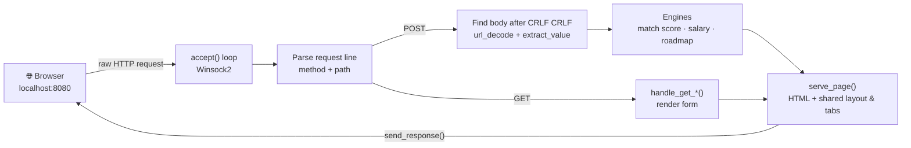

<div align="center">


**9 campus-placement tools served by an HTTP server I wrote from scratch in C, on raw Windows sockets.**


</div>

---

## ▸ Why C?

Every placement-prep site I found was either generic or locked behind a login. I wanted a tool that looks at **my** CGPA, **my** skills and **my** backlogs and tells me where I stand.

I also wanted to understand what a web framework *actually* does. So I built the whole thing (sockets, HTTP parsing, routing, form decoding, HTML rendering) in **plain C**, with nothing between my code and the network.

## ▸ The 9 tools

| Route | Tool | What it does |
|---|---|---|
| `/` | 🎯 **Eligibility Predictor** | Scores your profile (0–100) against 12 recruiters and estimates your salary band |
| `/resume` | 📄 **Resume Scorer** | Checks your resume against recruiting standards and lists concrete fixes |
| `/compare` | ⚖️ **Recruiter Comparison** | Two companies side by side: criteria, tier, pay, required skill |
| `/roadmap` | 🗺️ **Study Roadmap** | A week-by-week plan for your target domain and current level |
| `/interview` | 🎤 **Mock Interview Prep** | Company- and level-specific questions with answer hints |
| `/simulator` | 📈 **CGPA Simulator** | *"If I raise my CGPA to 8.0, which companies unlock?"* |
| `/backlogs` | 🧭 **Backlog Counselor** | Which companies still accept backlogs, plus a plan to clear them |
| `/resume-gen` | ✍️ **Tailored Resume Builder** | A resume draft that highlights what one recruiter looks for |
| `/reviews` | 💬 **Senior Reviews** | Placement experiences from seniors, filterable by company |

**Recruiters modelled:** Google · Microsoft · Amazon · Goldman Sachs · JP Morgan · Deloitte · Accenture · Infosys · TCS · Wipro · ISRO · L&T Technology, across **Tech, Finance, Consulting and Core** domains and tiers **A / B / C**.

## ▸ How the server works



## ▸ Engineering highlights

- **Winsock loaded at runtime.** Instead of linking `ws2_32.lib`, the program calls `LoadLibraryA("ws2_32.dll")` and resolves `socket`, `bind`, `listen`, `accept`, `recv` and `send` with `GetProcAddress`. That's why it compiles with **TinyCC**, which doesn't ship the Winsock import library.
- **My own HTTP layer.** Request-line parsing, a route table for 9 GET and 8 POST routes, `application/x-www-form-urlencoded` decoding (`url_decode`, `extract_value`) and response headers written by hand.
- **Escaping user text.** The resume builder runs free-text lists (skills, projects…) through `html_escape()` and `render_list_items()` before rendering them as `<li>` items.
- **A clear scoring model.** The match score adds explainable parts: CGPA margin over the cut-off (capped at 40), backlog policy, the required skill, skill breadth, projects, internships, and LeetCode count for tier-A tech. Salary scales the company's base with the score, CGPA and internships, kept within **70–130 %** of base.
- **Bounded memory.** `Student`, `Company` and `Prediction` are plain structs with fixed-size fields, and each page is built in one pre-sized heap buffer that's freed after it's sent.

<details>
<summary><b>Peek at the scoring function</b></summary>

```c
int compute_match_score(const Student *s, const Company *c) {
    int score = 0;
    if (s->cgpa >= c->min_cgpa) {
        float extra = s->cgpa - c->min_cgpa;
        score += 25 + (int)(extra * 3);
        if (score > 40) score = 40;
    } else if (c->min_cgpa - s->cgpa < 0.5f) score += 10;

    if (s->backlogs == 0)                           score += 10;
    else if (c->allow_backlogs && s->backlogs <= 2) score += 5;
    if (has_skill(s, c->required_skill))            score += 15;
    /* + skills breadth, projects, internships, LeetCode for tier-A tech */
    return score > 100 ? 100 : score;
}
```
</details>

## ▸ Run it (Windows)

1. Install **TinyCC** from [bellard.org/tcc](https://bellard.org/tcc/) and add `tcc` to your `PATH`.
2. Then:

```bat
git clone https://github.com/Stanvi09/PlacementAdvisor-app.git
cd PlacementAdvisor-app
build.bat
```

`build.bat` compiles `src/placement_advisor.c`, starts the server and opens **http://localhost:8080**.

<sub>Manual build: <code>tcc src\placement_advisor.c -o placement_advisor.exe</code></sub>

## ▸ Project structure

```
PlacementAdvisor-app/
├── src/
│   └── placement_advisor.c   # server, router, engines and HTML: one file
├── build.bat                 # compile + run with TinyCC
├── .gitignore                # keeps .exe files and toolchains out of git
└── README.md
```

## ▸ What I'd do next

- [ ] Split into modules: `http.c`, `router.c`, `engine.c`, `views.c`
- [ ] Port the socket layer to POSIX so it runs on Linux and macOS
- [ ] Load companies and reviews from a CSV/JSON file instead of compiled-in arrays
- [ ] Add a unit-test harness for the scoring and salary functions
- [ ] Escape *every* user-supplied field before it's echoed into HTML

---

<div align="center">

Built from scratch by **Tanvi Sadashiv**
<br/>
<a href="https://www.linkedin.com/in/tanvi-sadashiv-3713ba381"></a>
<a href="https://github.com/Stanvi09"></a>


</div>
